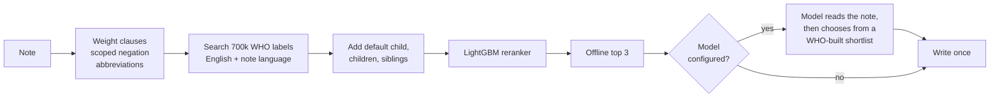

# ICD-11 coder

Reads an outpatient consult note and proposes up to three ICD-11 MMS 2026-01 codes, best first. It gives a complete answer with no network access, and uses a language model, when one is configured, to improve those answers within a fixed time and money budget.

```
docker compose build
docker compose run coder /in/notes.jsonl /out/predictions.jsonl
```

## Final metrics

| Evaluation set | Mode | Top-1 | Top-3 | Points | Cost per note |
|---|---|---|---|---|---|
| Dev, 60 notes, official `score.py` | Offline (no key) | 0.617 | 0.800 | **50.8 / 75** | $0 |
| Dev, 60 notes, official `score.py` | With model (DeepSeek V3.2) | 0.883 | 0.983 | **68.7 / 75** | $0.0023 |
| Held-out WHO notes, unseen code families, 2,387 | Offline | 0.744 | 0.837 | | $0 |
| Held-out WHO notes, 150-note sample | Offline / with model | 0.760 / 0.853 | 0.847 / 0.907 | | $0 / $0.0026 |

Offline coding takes about 20 ms a note; with the model, p95 latency is 12.5 s a note and 60 notes finish in under a minute. **Hidden-score estimate:** about **56 to 65 / 100** with no key and **79 to 88 / 100** with a key; the reasoning is in [docs/EVALUATION.md](docs/EVALUATION.md).

## How it works



Every note has an offline answer before any model call, so a timeout, an error or an empty budget can never leave a note blank. Supported models: Anthropic, OpenAI, any OpenAI-compatible server, and Amazon Bedrock. Details in [docs/ARCHITECTURE.md](docs/ARCHITECTURE.md).

## Data added

| Source | Content | Licence | Built by |
|---|---|---|---|
| WHO ICD-API, release 2026-01, official `whoicd/icd-api` container, retrieved 2026-11-04 | Index terms, inclusions, exclusions, definitions, coding notes, hierarchy | CC BY-ND 3.0 IGO | `tools/crawl_who_mms.py`, `tools/build_kb.py` |
| The same release in French, Spanish, Portuguese, Arabic, Russian and Chinese | Translated titles and terms | CC BY-ND 3.0 IGO | `tools/crawl_who_languages.sh` |
| 12,000 labelled notes generated from the WHO text above | Reranker training and held-out testing | Derived | `tools/build_who_notes.py` |
| Clinical abbreviation list | 90 general expansions | Written for this project | `src/icd_coder/abbreviations.py` |

ICD-11 content is copyright the World Health Organization and is used unaltered.

## Evaluation beyond the 60 dev notes

- **Held-out WHO terms** chose the label scoring (top-1 0.510 against 0.462 without coverage weighting) and showed WHO translations lifting French top-1 from 0.253 to 0.495.
- **Held-out code families:** the reranker is tested only on notes about families it never trained on. It improves top-1 by 2.3 points (95% interval +1.6 to +3.2).
- **Model path:** measured on dev and on held-out notes, broken down by note type, with cost and latency.
- **No leakage:** dev is never used for training or tuning, folds are grouped by code family, and held-out notes never choose settings.

## Where the AI tooling was wrong

The first negation rule written by Claude Code dropped any clause containing "no", so "Functional constipation (no alarm features)" lost its own diagnosis. It was caught during error analysis and replaced with a scoped rule that removes only the words after the negation, up to the end of the phrase. Other caught mistakes are listed in [DECISIONS.md](DECISIONS.md#ai-tooling-mistakes-caught).

## Authorship and documents

Code written by Claude Code. Research, guidance, design decisions and recommendations by Purv Kabaria.

[Architecture](docs/ARCHITECTURE.md) · [Design decisions](docs/DESIGN.md) · [Evaluation](docs/EVALUATION.md) · [Engineering](docs/ENGINEERING.md) · [Decision log](DECISIONS.md) · settings in [.env.example](.env.example)

Hours spent: about 3.5.
