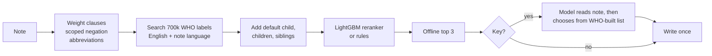

# ICD-11 coder

Reads an outpatient consult note and proposes up to three ICD-11 MMS 2026-01 codes, best first. It works fully offline, and uses an Anthropic, OpenAI or other compatible model, when a key is given, to improve its answers within a time and money budget.

```
docker compose build
docker compose run coder /in/notes.jsonl /out/predictions.jsonl
```

## Scores

| | Top-1 | Top-3 | Points |
|---|---|---|---|
| Dev, `score.py`, no key | 0.617 | 0.800 | **50.8 / 75** |
| Held-out WHO notes, unseen code families (2,387) | 0.744 | 0.837 | |
| **Hidden estimate, no key** | A 0.55 to 0.63, B 0.35 to 0.45 | A 0.75 to 0.82, B 0.50 to 0.60 | **about 56 to 65 / 100** |

A key should raise slice B most (any language, paraphrase), but the model path could not be measured without one, so it is not in the estimate. Reasoning: [docs/EVALUATION.md](docs/EVALUATION.md).

## How it works



Offline answers exist for every note before any model call, so a timeout, failure or empty budget can never leave a note blank. Details: [docs/ARCHITECTURE.md](docs/ARCHITECTURE.md).

## Data added

| Source | What | Licence | Built by |
|---|---|---|---|
| WHO ICD-API, release 2026-01, official container `whoicd/icd-api`, crawled 2026-11-04 | Index terms, inclusions, exclusions, definitions, coding notes, hierarchy | CC BY-ND 3.0 IGO, credit WHO | `tools/crawl_who_mms.py`, `tools/build_kb.py` |
| Same, in French, Spanish, Portuguese, Arabic, Russian, Chinese | Translated titles and terms | Same | `tools/crawl_who_languages.sh` |
| 12,000 training notes built from WHO text, no model calls | Reranker training and held-out test | Derived from the above | `tools/build_who_notes.py` |
| General clinical abbreviation list | 90 expansions | Written for this repo | `src/icd_coder/abbreviations.py` |

ICD-11 content is copyright the World Health Organization and is used unaltered.

## Evaluation beyond the 60 dev notes

- **Held-out WHO terms:** hide one WHO term per code and search for it. This chose the label scoring (top-1 0.510, against 0.462 without the coverage term) and showed translations lifting French from 0.253 to 0.495.
- **Held-out code families:** 2,387 notes about families the reranker never trained on. Top-1 0.721 to 0.744 over the rules, 95% interval +1.6 to +3.2 points. The hard kind (paraphrased definitions) went 0.425 to 0.483.
- **Leakage rules:** dev is never training data, folds are grouped by family, and held-out notes only report results, never choose settings.

## Where the AI tooling was wrong

Claude Code's first negation rule dropped any clause containing "no". Error analysis on a dev miss showed "Functional constipation (no alarm features)" losing the diagnosis itself. I replaced it with a scoped rule that removes only the words after the cue, up to the end of the phrase. This was one of the fixes that moved dev top-1 to 0.600. Other caught mistakes are logged in [DECISIONS.md](DECISIONS.md#ai-tooling-mistakes-caught).

## More

[Design choices and alternatives](docs/DESIGN.md) · [Engineering principles](docs/ENGINEERING.md) · [Decision log](DECISIONS.md) · settings in [.env.example](.env.example) · checks: `uv run ruff check`, `uv run mypy --strict src`, `uv run pytest` (88 tests).

Hours spent: about 3.
