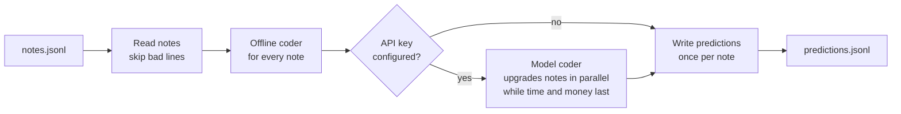
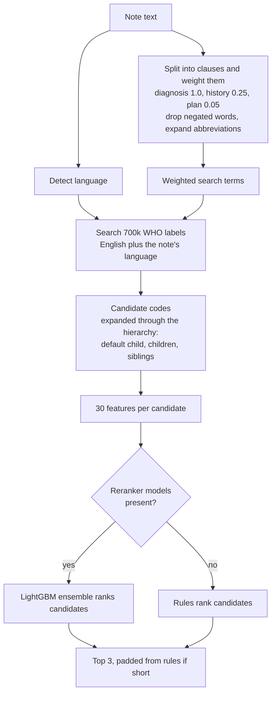
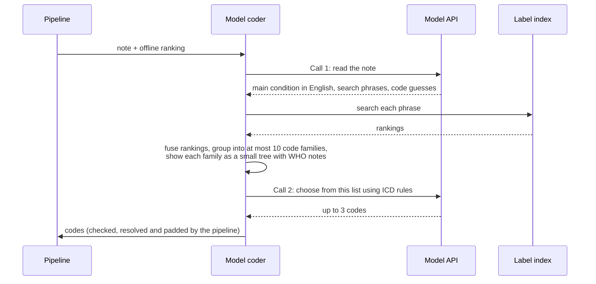
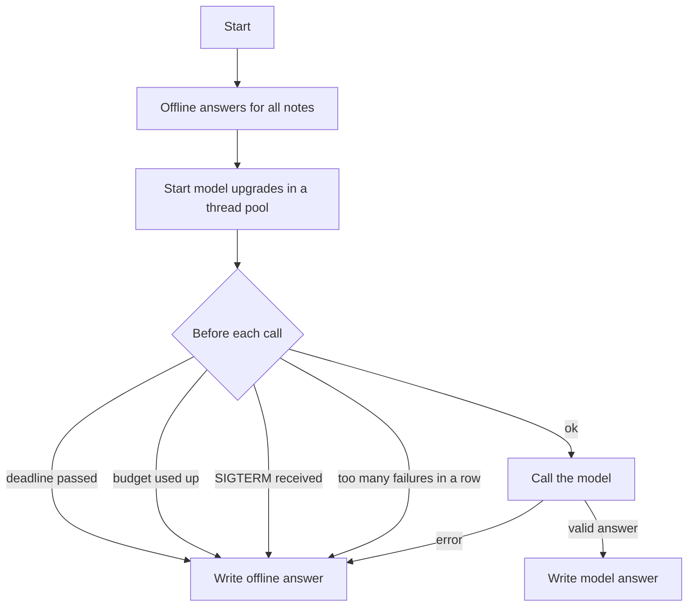
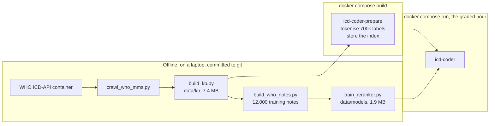

# Architecture

This page explains how the coder turns a consult note into three ICD-11 codes, which part of the code does each step, and why the pieces are arranged this way.

## The problem in one paragraph

A note comes in as free text: a typed consult, a short one-liner or a transcript of a conversation, sometimes not in English. The coder must return up to three codes from a fixed list of 18,375 ICD-11 MMS categories, best first. The answer is graded on whether the right code is first (two thirds of the points) or anywhere in the top three (one third). The right code is the most specific one the note supports, so "malaria" alone should become "malaria, unspecified", not the parent "malaria" heading. The whole run gets one hour, 8 CPUs, no GPU and at most US$6 of model calls, and must still work with no API key at all.

## The big picture

Two coders work together:

| Coder | Needs network | Speed | Role |
|---|---|---|---|
| Offline coder | No | About 20 ms per note | Answers every note first. This is the safety net and the no-key answer. |
| Model coder | Yes (Anthropic, OpenAI or any OpenAI-compatible server) | Seconds per note | Tries to improve each answer. If it fails, runs out of time or runs out of money, the offline answer is used. |

The offline coder always runs first, for every note, before any model call. That one ordering rule is what makes the system safe: whatever happens later, every note already has a good answer.

## Inside the offline coder

Step by step:

1. **Read the note like a clinician.** `clinical_text.py` splits the note into clauses and gives each one a weight. A clause under "Assessment" or "Diagnosis", or a doctor saying "this is ...", counts fully. History counts a quarter. Plans count very little. Words after "no" or "denies" are removed, but only up to the end of that phrase, so "no fever, has malaria" keeps "malaria". In transcripts, what the patient says counts less than what the doctor says. Abbreviations such as "AF" or "UTI" are expanded.
2. **Search WHO's own words.** Every ICD-11 title, index term, inclusion and translation is stored as a separate short "label" (about 700,000 in total). `lexical.py` scores each label by how much of it the note covers, weighted by how rare each word is. A label that is fully mentioned beats one that is half mentioned, and a longer fully mentioned label ("acute amoebic dysentery") beats a shorter one ("dysentery"). The search only touches labels that share a word with the note, which keeps it fast.
3. **Widen the candidate list through the hierarchy.** `features.py` takes the codes found and adds their relatives: the default child of a heading (for example `.Z` "unspecified"), its leaf children and its siblings. This puts the right level of detail on the list even when the note never names it. On held-out notes, the right code is on this list 93% of the time.
4. **Rank the candidates.** If trained models are present in `data/models`, a LightGBM ensemble scores each candidate from 30 features (how well it matched, in which part of the note, its place in the hierarchy, whether it is the default child, the note's language and length). Otherwise rules choose: a child replaces its parent only when the note supports it better than the parent, and a heading with nothing more specific becomes its default child.
5. **Always return three distinct, valid codes.** A short list is padded from the rules.

## Inside the model coder

The model never invents codes from memory. Models misremember ICD-11 codes (during testing one guessed `1A61.0` for malaria), so it only chooses from a list the coder built from WHO data. Its answer is then checked against the official code list, resolved to the most specific valid code and padded from the offline answer.

## How a run is kept safe

| Guard | Default | Where |
|---|---|---|
| Wall-clock deadline | 45 minutes of the 60 | `guards.py` |
| Money ceiling | US$4.50 of the US$6 cap, checked against a worst-case price before each call | `guards.py`, `llm/coder.py` |
| Failure streak | Stop calling after 12 failures in a row | `guards.py` |
| Stop signal | SIGTERM finishes with offline answers | `cli.py` |
| Bad model output | Invalid codes dropped, list padded | `pipeline.py` |
| One note crashing | Caught and logged with the note id; that note falls back | `pipeline.py` |

Each prediction line is written exactly once, when it is final, and flushed immediately. The scorer keeps the first line for each id, so a "draft" line could never be corrected later.

## Build time versus run time

Heavy work happens once, while the Docker image is built, never during the graded hour.

## Where each piece lives

| Module | Job |
|---|---|
| `cli.py` | Command line entry points: `icd-coder` (run) and `icd-coder-prepare` (build the index). |
| `config.py` | Reads every setting from the environment once, into one frozen object. |
| `notes.py` | Reads notes tolerantly (bad lines are skipped, not fatal) and writes each prediction once. |
| `pipeline.py` | Runs the offline coder for all notes, then the model upgrades, under the guards. |
| `guards.py` | Deadline, budget and failure streak. |
| `catalogue.py` | The 18,375 scoreable codes with WHO knowledge, the hierarchy and the default-child rules. |
| `text.py` | Normalising and splitting text into search terms (shared by notes and labels, so they always agree). |
| `abbreviations.py` | A general list of clinical abbreviations. |
| `clinical_text.py` | Finding diagnostic statements, negation and speakers in a note. |
| `language.py` | Detecting the note's language cheaply. |
| `lexical.py` | The label index and its search. |
| `index_store.py` | Building the index once and caching it, keyed by a hash of its inputs and code. |
| `offline.py` | The offline coder: reranker when present, rules otherwise. |
| `features.py` | Candidate codes and their 30 features, shared by training and running. |
| `reranker.py` | Loads and runs the LightGBM ensemble. |
| `evaluation.py` | The official metrics plus extra diagnostics. |
| `llm/providers.py` | One interface over Anthropic, OpenAI and any OpenAI-compatible server, with cost from usage. |
| `llm/rate_limit.py` | Keeps a client under a tokens-per-minute limit. |
| `llm/prompts.py` | The two prompts and their JSON schemas. |
| `llm/candidates.py` | Builds the family trees the model chooses from. |
| `llm/coder.py` | The two-call model coder. |
| `llm/factory.py` | Picks and builds the provider from settings. |

Tools and experiments sit outside the package because the runtime never needs them:

| Path | Job |
|---|---|
| `tools/crawl_who_mms.py`, `tools/crawl_who_languages.sh` | Crawl WHO's ICD-API container (English and six translations). |
| `tools/build_kb.py` | Turn the crawl into the compact knowledge base in `data/kb`. |
| `tools/build_who_notes.py` | Build labelled training notes from WHO text, with no model calls. |
| `tools/train_reranker.py` | Cross-validate, train and save the reranker ensemble. |
| `tools/synthesize.py` | Generate LLM-written notes for evaluation (paused; see [DESIGN.md](DESIGN.md)). |
| `tools/evaluate.py` | Run the full pipeline on a labelled set and report quality, cost and speed. |
| `experiments/` | Small benchmarks used to make specific choices. |

## Words used in these docs

| Word | Meaning here |
|---|---|
| Code, category | One entry in the ICD-11 MMS list, such as `1F40.Z`. |
| Leaf | A code with no children. Gold answers are almost always leaves. |
| Default child | The child to use when the note gives no more detail, usually the `.Z` "unspecified" code. |
| Family | A top-level code and everything under it. Used to keep training and test data apart. |
| Label | One short piece of WHO text (a title, index term, inclusion or translation) pointing at one code. |
| Candidate | A code the coder is considering for a note. |
| Reranker | A trained model that puts candidates in order. |
| Top-1, top-3 | Share of notes whose right code is first, or anywhere in the first three. |
| Held out | Data kept away from training and tuning, used only to measure. |
