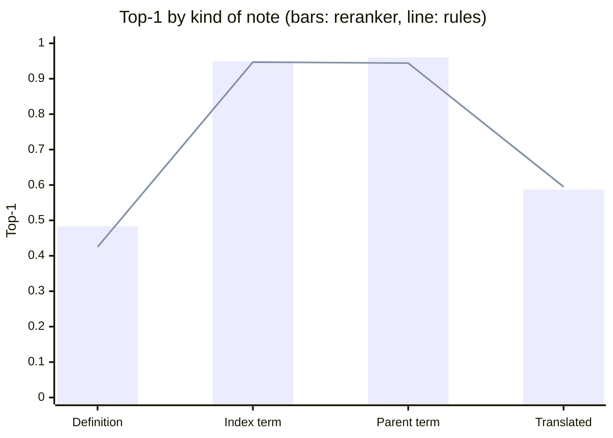

# Evaluation

How the coder was measured, on which data, and what the numbers do and do not show.

## What is measured

| Metric | Meaning | Why |
|---|---|---|
| Top-1 | The right code is first | Two thirds of the official points |
| Top-3 | The right code is in the first three | One third of the official points |
| MRR | Average of 1 / position of the right code | Separates "second" from "third" |
| Family top-1 | The first code is in the right family | Shows near misses (right disease, wrong detail) |
| Chapter top-1 | The first code is in the right chapter | Shows how far off a miss is |
| Candidate recall | The right code is anywhere on the candidate list | The ceiling a reranker can reach |
| Invalid and missing rate | Codes not in the list, notes without a line | Must be zero |

`tools/evaluate.py` runs the real pipeline end to end and also checks its headline numbers against the official `score.py`.

## Data sets

| Set | Notes | Made by | Used for |
|---|---|---|---|
| Dev (provided) | 60 | The graders | Error analysis during the first round only, then a final regression check |
| Held-out WHO terms | One per code | Hiding one WHO index term per code and searching for it | Choosing the label scoring and checking translations |
| WHO notes, training | 9,613 | `tools/build_who_notes.py` | Training and cross-validating the reranker |
| WHO notes, held out | 2,387 | Same tool, families never used in training | Reporting only, never choosing settings |
| LLM-written notes | Paused | `tools/synthesize.py` (Qwen writer, gpt-oss judge) | Planned as the closest stand-in for hidden notes |

How leakage is prevented is described in [ENGINEERING.md](ENGINEERING.md#10-no-leakage-between-training-and-testing).

## Results

### Dev notes (slice A style, 60 notes)

| Version | Top-1 | Top-3 | Points of 75 |
|---|---|---|---|
| First offline version | 0.550 | 0.767 | 46.7 |
| Default child and number fixes | 0.567 | 0.750 | 47.1 |
| Negation scope, headers, speakers, abbreviations | 0.600 | 0.817 | 50.4 |
| With the reranker (final, no key) | 0.617 | 0.800 | 50.8 |

Sixty notes is a small sample: one note moves top-1 by 1.7 points. The last row is within noise of the one above; the reranker was kept because of the larger held-out test below, not because of dev.

### Reranker on held-out code families (2,387 notes)

| Ranking | Top-1 | Top-3 | MRR | Family top-1 |
|---|---|---|---|---|
| Rules | 0.721 | 0.800 | 0.756 | 0.798 |
| Reranker | 0.744 | 0.837 | 0.785 | 0.806 |

The 95% confidence interval for the top-1 gain (paired bootstrap) is +1.6 to +3.2 points, so the gain is real. Cross-validation on the training families agrees (top-1 0.707 to 0.734).

By kind of note:

| Kind | Notes | Rules top-1 | Reranker top-1 | Rules top-3 | Reranker top-3 |
|---|---|---|---|---|---|
| Paraphrased WHO definition | 866 | 0.425 | 0.483 | 0.538 | 0.612 |
| Noisy index term | 829 | 0.947 | 0.949 | 0.982 | 0.986 |
| Parent term, default child is right | 445 | 0.944 | 0.960 | 0.982 | 0.989 |
| Translated WHO title | 247 | 0.595 | 0.587 | 0.781 | 0.858 |

Reading the table honestly: notes that use WHO's own wording are nearly solved, and they flatter the average. Paraphrase is the hard case and where the reranker helps most. Translated notes gain in top-3 but not top-1.

### Translations (held-out WHO terms)

| Language | English labels only | With WHO translations |
|---|---|---|
| French | 0.253 | 0.495 |
| Spanish | 0.159 | 0.497 |

### Label scoring choice (held-out WHO terms, top-1)

| Coverage power | 0 | 1 | 2 | 3 |
|---|---|---|---|---|
| Top-1 | 0.462 | 0.510 | 0.489 | 0.471 |

## Estimate of the hidden score

The estimate is for the no-key path, which is what has been measured.

| Slice | Basis | Top-1 | Top-3 | Points |
|---|---|---|---|---|
| A (450 notes, same clinics as dev) | Dev 0.617 / 0.800, widened for the small sample | 0.55 to 0.63 | 0.75 to 0.82 | 46 to 52 of 75 |
| B (150 notes, every chapter, several languages) | Between the paraphrase and translated results above, lowered for real consult noise and for Swahili or Hindi notes with no WHO translation | 0.35 to 0.45 | 0.50 to 0.60 | 10 to 13 of 25 |
| Total | | | | about 56 to 65 of 100 |

With an Anthropic or OpenAI key the model path should add to this, mostly on slice B, where it can read any language and paraphrase. Its accuracy is not measured yet, because no key was available while building, so it is not counted in the estimate.

## Known weaknesses

| Weakness | Effect | Next step |
|---|---|---|
| No WHO translation for Swahili, Hindi, Gujarati | Those notes rely on shared medical words when there is no key | A small multilingual embedding model baked into the image |
| Template training notes are cleaner than real consults | The reranker may gain less on real notes than on held-out WHO notes | Train on LLM-written notes from a different model family |
| Model path unmeasured | Unknown gain and cost on real notes | Run `tools/evaluate.py` with a key on held-out sets |
| Dev is 60 notes from one setting | Small, narrow regression check | Treat dev movements under 2 points as noise |
