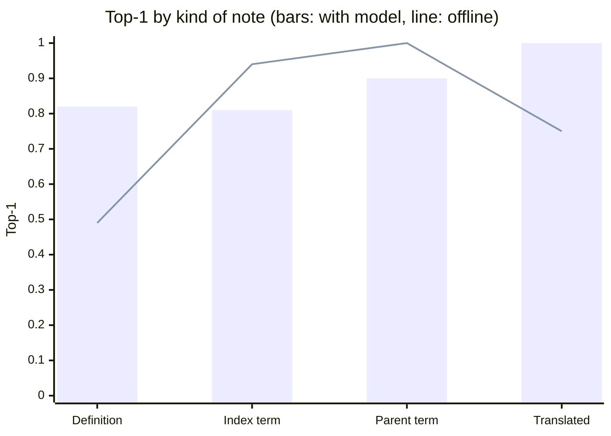

# Evaluation

This document reports how well the coder performs, how that was measured, and what the numbers can and cannot tell us.

## Summary

| Mode | Dev top-1 | Dev top-3 | Dev points (of 75) | Held-out top-1 | Held-out top-3 | Cost per note |
|---|---|---|---|---|---|---|
| Offline, no key | 0.617 | 0.800 | 50.8 | 0.760 | 0.847 | $0 |
| With model (DeepSeek V3.2) | 0.883 | 0.983 | 68.7 | 0.853 | 0.907 | $0.0023 to $0.0026 |

Held-out figures are on the same 150-note sample of held-out WHO notes for both modes. The offline coder on all 2,387 held-out notes scores 0.744 top-1 and 0.837 top-3.

## Metrics

| Metric | Meaning |
|---|---|
| Top-1 | The correct code is first. Two thirds of the official points. |
| Top-3 | The correct code is among the first three. One third of the official points. |
| MRR | The average of 1 / position of the correct code. |
| Family top-1 | The first code is in the correct family: right disease, possibly wrong detail. |
| Chapter top-1 | The first code is in the correct chapter. |
| Candidate recall | The correct code is on the candidate list at all; the ceiling for ranking. |
| Invalid and missing rate | Codes outside the official list, and notes without a line. Both are zero in every run. |

`tools/evaluate.py` runs the real pipeline end to end, reports these metrics with cost and latency, and checks its headline figures against the official `score.py`.

## Data sets

| Set | Size | Origin | Role |
|---|---|---|---|
| Dev | 60 notes | Provided with the task | Regression check. Used for error analysis in the first development round only, never for training or tuning. |
| Held-out WHO terms | One per code | One WHO index term per code hidden from the index and used as a query | Choosing the label scoring and checking translations |
| WHO training notes | 9,613 notes | `tools/build_who_notes.py` | Training and cross-validating the reranker |
| WHO held-out notes | 2,387 notes | The same generator, on code families excluded from training | Reporting only |

The WHO notes come in four kinds, which behave very differently and are reported separately:

| Kind | What the note contains | What it tests |
|---|---|---|
| Definition | A paraphrase of the code's WHO definition, which is never searched | Understanding a description that does not name the condition |
| Index term | A WHO synonym with noise: a dropped word, an abbreviation, lower case | Matching clinicians' wording |
| Parent term | Only the parent condition; the correct answer is its default child | Choosing the right level of detail |
| Translated | The WHO title in French, Spanish, Portuguese, Russian, Arabic or Chinese | Notes not in English |

## Results

### Dev (60 notes, official scorer)

| Mode | Top-1 | Top-3 | MRR | Family top-1 | Points |
|---|---|---|---|---|---|
| Offline, rules only | 0.600 | 0.817 | 0.700 | 0.733 | 50.4 |
| Offline, with reranker | 0.617 | 0.800 | 0.703 | 0.800 | 50.8 |
| With model | 0.883 | 0.983 | 0.933 | 0.950 | 68.7 |

One note moves top-1 by 1.7 points, so the two offline rows are equivalent within noise. The reranker is shipped because of the larger held-out test below.

### Reranker on held-out code families (2,387 notes)

| Ranking | Top-1 | Top-3 | MRR | Family top-1 |
|---|---|---|---|---|
| Rules | 0.721 | 0.800 | 0.756 | 0.798 |
| Reranker | 0.744 | 0.837 | 0.785 | 0.806 |

The 95% paired-bootstrap interval for the top-1 gain is +1.6 to +3.2 points. Five-fold cross-validation on the training families agrees: 0.707 to 0.734.

| Kind | Notes | Rules top-1 | Reranker top-1 | Rules top-3 | Reranker top-3 |
|---|---|---|---|---|---|
| Definition | 866 | 0.425 | 0.483 | 0.538 | 0.612 |
| Index term | 829 | 0.947 | 0.949 | 0.982 | 0.986 |
| Parent term | 445 | 0.944 | 0.960 | 0.982 | 0.989 |
| Translated | 247 | 0.595 | 0.587 | 0.781 | 0.858 |

### Model path on held-out notes (150-note sample)

| Kind | Notes | Offline top-1 | With model top-1 | Offline top-3 | With model top-3 |
|---|---|---|---|---|---|
| Definition | 57 | 0.49 | 0.82 | 0.65 | 0.89 |
| Index term | 47 | 0.94 | 0.81 | 0.96 | 0.87 |
| Parent term | 30 | 1.00 | 0.90 | 1.00 | 0.93 |
| Translated | 16 | 0.75 | 1.00 | 0.94 | 1.00 |
| All | 150 | 0.760 | 0.853 | 0.847 | 0.907 |

The model is much stronger where understanding matters (paraphrase, other languages) and weaker where the note already uses WHO's exact wording, where it sometimes replaces a correct offline answer. Those easy notes are over-represented in WHO-generated data and rarer in real consults.

### Supporting measurements

| Question | Result |
|---|---|
| Label scoring: coverage power 0 / 1 / 2 / 3 (held-out WHO terms, top-1) | 0.462 / **0.510** / 0.489 / 0.471 |
| WHO translations, French top-1 (English labels only vs with translations) | 0.253 vs 0.495 |
| WHO translations, Spanish top-1 | 0.159 vs 0.497 |
| Candidate recall on held-out notes | 0.933 |

## Cost and speed

| Measure | Offline | With model |
|---|---|---|
| Time for 60 dev notes | 1.2 s | 57 s at 6 parallel calls |
| Latency per note | about 20 ms | p50 5.1 s, p95 12.5 s |
| Cost per note | $0 | $0.0023 (dev), $0.0026 (held-out) |
| Projected cost for 600 notes | $0 | about $1.50, inside the US$4.50 budget |

## Model used for measurement

The grading run uses Anthropic or OpenAI, but no key for either was available for this project. The model path was therefore measured with DeepSeek V3.2 on Amazon Bedrock, through the same prompts and the same pipeline; the prompts were not changed or tuned for it. Claude on Bedrock could not be used because AWS sells it through Marketplace, which promotional credits do not cover. With Claude Haiku 5.5 the gain should be of a similar size, but that is an expectation, not a measurement.

## Hidden-score estimate

| Slice | Basis | No key | With key |
|---|---|---|---|
| A, 450 notes, same clinics as dev | Dev results, widened for the sample size of 60 | 0.55 to 0.63 top-1, 0.75 to 0.82 top-3: **46 to 52 / 75** | 0.80 to 0.88 top-1, 0.92 to 0.97 top-3: **63 to 68 / 75** |
| B, 150 notes, every chapter, several languages | Held-out results by kind, lowered for real consult noise and for languages WHO has not translated | 0.35 to 0.45 top-1, 0.50 to 0.60 top-3: **10 to 13 / 25** | 0.60 to 0.75 top-1, 0.75 to 0.85 top-3: **16 to 20 / 25** |
| Total | | **56 to 65 / 100** | **79 to 88 / 100** |

## Limitations

| Limitation | Effect | Mitigation |
|---|---|---|
| Dev is 60 notes from one setting | Wide uncertainty on slice A | Dev differences under 2 points are treated as noise |
| WHO-generated notes are cleaner than real consults | Held-out figures are optimistic, especially for index-term notes | Results are reported by note kind, not only as an average |
| Model path measured with DeepSeek V3.2, not Claude or GPT | Grading-time gain may differ | Same prompts and pipeline; validation and offline fallback protect against a weaker model |
| No WHO translation for Swahili, Hindi or Gujarati | Offline answers for those notes rely on shared medical words | With a key, the model reads any language |
| The model sometimes overrides a correct exact-match answer | Lost points on easy notes | Combining both answers is the clearest next improvement |
